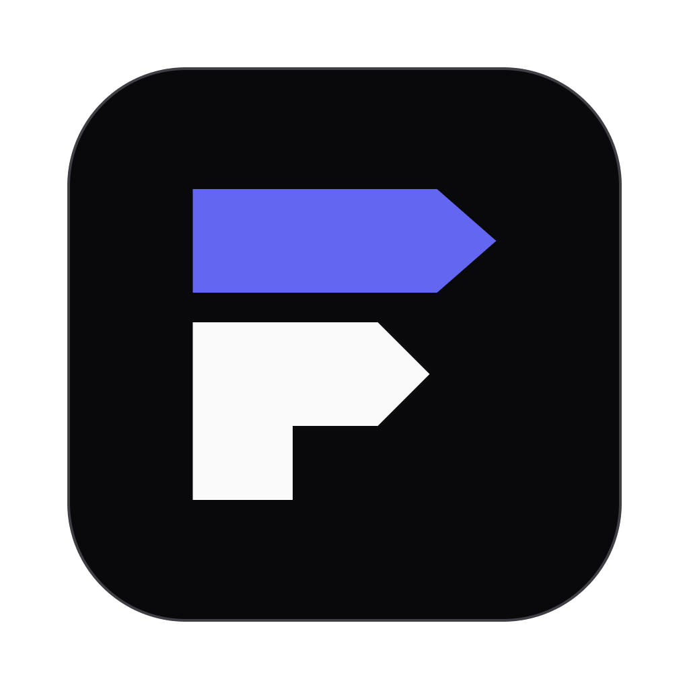

<p align="center">
  
</p>

# T3 Factory

**Compose AI development workflows. Run them on T3. Keep human decisions in the loop.**

[](https://github.com/alimek/t3-factory/actions/workflows/quality.yml)
[](LICENSE)

T3 Factory is a local application for turning reusable AI Agents into visual software
development workflows. Connect implementation, review and Human steps, add correction
loops or parallel branches, then follow each Run from one place. T3 provides the agent
conversations and execution through [T3 Code](https://t3.codes/); Factory stores your
workflow, routes work and records its history.

[Try the demo](#try-the-demo) · [Run with T3](#run-with-t3) · [Documentation](docs/README.md) · [Contributing](CONTRIBUTING.md)

## What you can do

- **Design Flows visually.** Connect Agent and Human blocks with named exits,
  correction loops and independent parallel branches, and add Continuations that prompt an
  earlier Agent again in its own conversation. Save unfinished drafts and check readiness.
- **Reuse Agents across projects.** Save prompts and worker settings once. Factory launches
  each Block with that Agent's provider and model.
- **Keep decisions with people.** Answer Human steps in Factory and open T3 for native
  agent questions or permissions. See which Runs need input or have a Problem.
- **Follow durable execution.** Inspect the execution canvas, handoffs and timeline;
  keep each Run's captured definitions and history across backend restarts. Settle or archive a Run, or start a new one.
- **Work locally or from an approved device.** Use the browser on the host, or connect
  an approved desktop/browser client through the separate HTTPS listener.

A typical Flow might send implementation work to an Agent, route it through review,
return requested corrections, then ask a person for approval. You decide the blocks
and exits; Factory does not impose a fixed development process.

## Project status

**Early development.** Source installation and the simulated demo are the best starting
points. Controlled tests cover Factory behavior; live T3 compatibility depends on the
specific build, harness and permissions. Factory-launched workers and the `$factory-block`
skill still need further live qualification. See the [support limits](docs/installation.md#compatibility-and-support-limits).

The macOS Apple Silicon desktop app can be built from source. A developer package is
not a signed, notarized public release; see [Release](docs/release.md).

## Requirements

| Requirement | Details |
| --- | --- |
| Node.js | Version pinned in [`.node-version`](.node-version) and [`.nvmrc`](.nvmrc) |
| pnpm | Version pinned in [`package.json`](package.json) (`packageManager`) |
| Native build tools | Python and a C/C++ toolchain for `fs-ext`; on macOS, Xcode Command Line Tools |
| Storage | Local filesystem with working `flock` semantics; network filesystems are unsupported |
| T3 | Needed for real agent work; the demo uses a simulator |

macOS arm64 has been exercised. Linux is a backend implementation target with CI
checks, but is not a verified release host. Windows, Intel Mac desktop and Linux
desktop are unsupported release targets. See the full [platform matrix](docs/installation.md#platform-and-runtime).

## Try the demo

Install the pinned Node and pnpm versions, then:

```sh
git clone https://github.com/alimek/t3-factory.git
cd t3-factory
pnpm install --frozen-lockfile
pnpm dev
```

Open the frontend URL printed by Vite. A fresh demo home contains sample Agents,
Flows and Runs backed by simulated T3. **No T3 connection, OAuth approval, model
credentials or paid model work is required.** The demo does not execute real agents.

Demo edits persist in `~/.t3-factory-dev`, separately from production data. To use
another location, set `FACTORY_DEV_HOME` to an absolute path outside the checkout.
If an older development database prevents seeding, startup asks for `pnpm db:reset`.
To keep the old data, set `FACTORY_DEV_HOME` to a new empty location.

To restore the sample scenarios, stop the dev command and run:

```sh
pnpm db:reset
pnpm dev
```

Reset discards demo database edits and Run history. See the [scenario catalog](docs/dev-scenarios.md)
and [storage/reset behavior](docs/installation.md#reset-and-seed).

## Run with T3

From the installed checkout:

```sh
pnpm build
pnpm start
```

Open <http://127.0.0.1:4310>. The foreground backend serves the built UI and API;
T3 runs separately. Factory data is stored in `~/.t3-factory`, outside the checkout.

1. Start T3 with access to the local repository you want to work on.
2. In **Settings → T3 connection**, save T3's MCP endpoint and choose **Authorize on
   backend host**. Complete approval in the browser on that host.
3. In **Settings → Agent reporting**, install Factory MCP for the supported local
   harness homes you intend to use. Start fresh harness sessions when required.
4. In **Studio → Agents**, create reusable prompts and choose each Agent's worker settings.
5. In **Studio → Flows**, connect blocks and exits, save the Flow and check readiness.
6. Open **New Run**, choose the project and Flow, and enter your prompt.

Start checks connection, project, settings and reporting readiness. It preserves
unavailable choices and explains what needs attention. Setup does not launch a test workload.
Real Runs use your configured model providers and may incur their normal charges.

Ctrl+C stops the Factory backend. **Backend exit is not Archive:** agent work in T3
may continue. Use **Archive…** in the Run's ··· menu to end a Run and interrupt its workers; Archive does not undo edits.

For endpoint setup, configuration and client access, see
[installation](docs/installation.md), [T3 integration](docs/t3-integration.md) and
[desktop and approved clients](docs/desktop-and-clients.md).

## Development

| Command | Purpose |
| --- | --- |
| `pnpm dev` | Simulated demo with source reload and a separate persistent home |
| `pnpm build` | Build the workspace, including desktop bundles |
| `pnpm start` | Serve the built app with production data |
| `pnpm check` | Format check, fallow, lint, typecheck, behavior tests and build |
| `pnpm test:e2e` | Controlled Chromium journeys; build first |
| `pnpm desktop:package` | Create a local macOS arm64 developer package |

`pnpm dev:prod` provides source reload against **real production data and T3**.
Stop any other backend using that home first. See [development modes](docs/installation.md#development-and-production-commands).

The workspace uses TypeScript, React, Vite+, Tailwind CSS, Effect, SQLite and Electron.
Shared contracts and domain validation keep the frontend, backend and desktop aligned.
Read the [contribution guide](CONTRIBUTING.md) before changing behavior.

## Documentation and support

- [Documentation index](docs/README.md) — user guides and development contracts.
- [Studio](docs/studio.md) and [Runs](docs/runs.md) — authoring and execution behavior.
- [Glossary](GLOSSARY.md) — shared terminology.
- [Support](SUPPORT.md) — questions, bug reports and feature requests.
- [Security policy](SECURITY.md) — private vulnerability reporting and trust boundaries.
- [Community standards](CODE_OF_CONDUCT.md) — expectations for participation.

## License

[MIT](LICENSE) © 2026 Grzegorz Mandziak.
